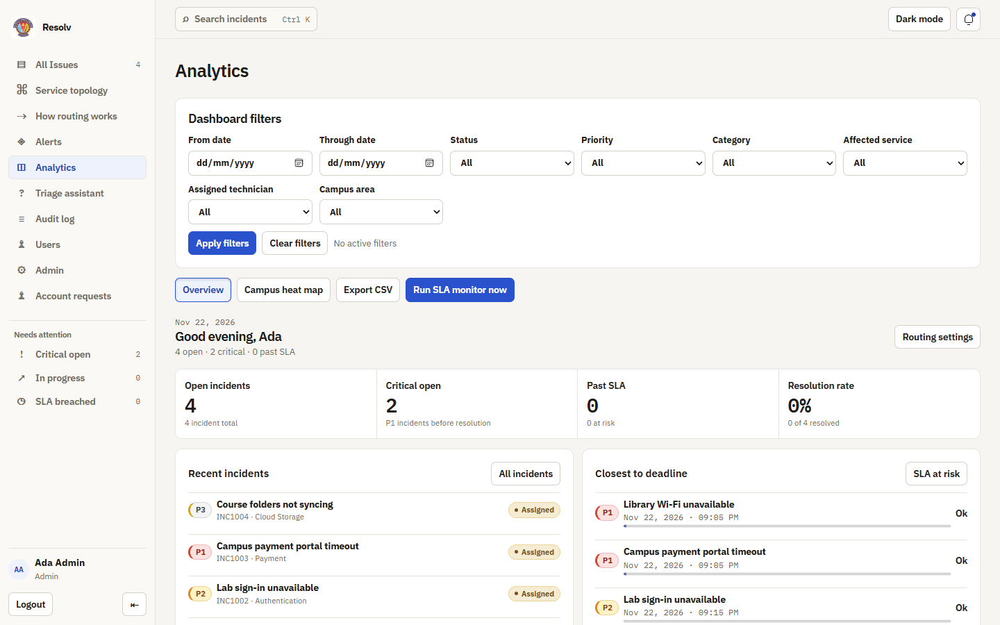
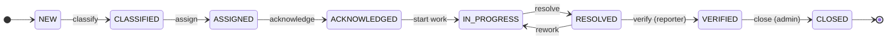
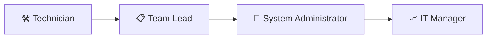
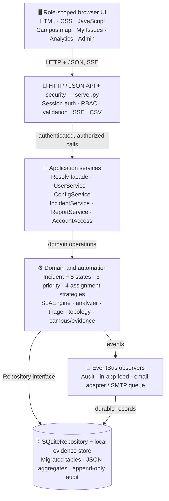
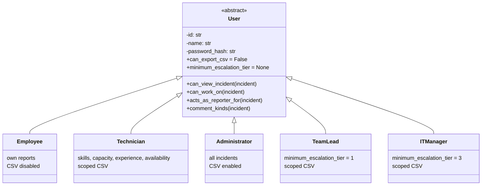
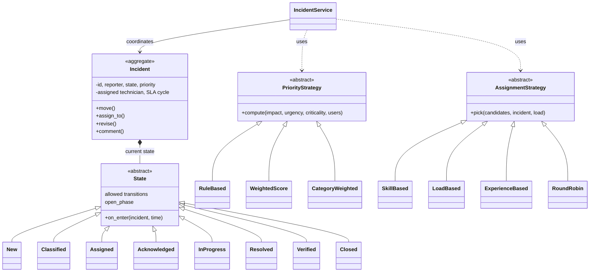
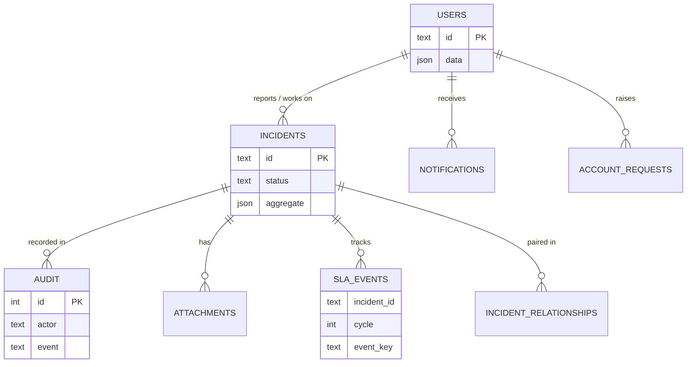

<div align="center">

# Resolv

### From first report to verified fix.

**Intelligent IT Service Management and Incident Resolution for the BITS Pilani Hyderabad Campus**

A role-based campus service desk built with the Python standard library, SQLite and plain JavaScript, with no web framework.<br>
Every incident follows a guarded lifecycle with explainable priority, technician routing, SLAs, escalation and an audit trail.


[Quick start](#-quick-start) ·
[Highlights](#-highlights) ·
[Demo](#-demo-workflows) ·
[Lifecycle](#-incident-lifecycle) ·
[How decisions are made](#-how-decisions-are-made) ·
[Architecture](#-architecture) ·
[OOP design](#-object-oriented-design) ·
[Testing](#-testing-and-validation) ·
[Docs](#-project-documents)

<br>



<sub>Administrator analytics with sample campus incidents, captured from the running app.</sub>

</div>

---

## 💡 Why Resolv?

When Wi-Fi goes down in a library reading area, the person reporting it wants to know who picked it up and when it will be fixed. Campus networks, sign-in systems, printers, labs and enterprise apps all fail sooner or later. When they do, a helpdesk has to collect usable evidence, choose the right urgency, find the right technician, and stay accountable until the fix is verified. **Chat messages and spreadsheets break the history apart and make service targets impossible to enforce.**

Resolv gives the reporter, technician and administrator **one shared incident record** from first report through verification and closure.

| Who | Pain today | What Resolv gives them |
| --- | --- | --- |
| 🧑‍🎓 **Employees** | No consistent reporting channel; little visibility into status | Signed-in intake, campus map, attachments, personal issue list, verification |
| 🛠️ **Technicians** | Unclear assignments and competing workload | Queue limited to their own work, acknowledgement, notes, resolution and capacity controls |
| 🧭 **Administrators** | Manual routing, SLA tracking and weak accountability | Configurable policies, dispatch, monitoring, audit and analytics |
| 📈 **Team leads / IT managers** | Late notice of critical unresolved issues | Visibility gated by escalation tier, with manual escalation |
| 🏫 **Campus operations** | Recurring infrastructure failures go unexplained | Service topology, correlation suggestions, location aggregation and CSV |

> [!NOTE]
> **Design principle:** automation *assists* and never silently overrides people. Duplicate links are reviewable, category suggestions come with a reason, and the external AI adapter is strictly opt-in.

---

## 🚀 Quick start

Requires **Python 3.12+**. No packages are needed for the core app.

```sh
python start_demo.py
```

Open **http://127.0.0.1:8765** and sign in with the demo password printed in the terminal.

| Demo account | Workspace | Try this first |
| --- | --- | --- |
| `E1` / `E2` | Employee | Open **My Complaints**, then **+ Raise Issue** |
| `T1` / `T2` / `T3` | Technician | Open **Assigned Issues** and sign in as the technician shown on your new ticket |
| `A1` | Administrator | Open **All Issues**, **Analytics** or **Audit log** |

<details>
<summary><b>Launcher tips</b></summary>

- Keep the terminal running during the demo. Press <kbd>Ctrl</kbd>+<kbd>C</kbd> to stop.
- Port busy? Use `python start_demo.py --port 8766`.
- Keep `.resolv-local.db` and `.resolv-local-password` together. If they disagree, the launcher stops and explains how to recover.
- `python start_demo.py --reset-demo-password` resets **only** the six original demo users. Incidents, evidence and settings are kept.
- On macOS/Linux, use `python3` if that is your Python command.

</details>

<details>
<summary><b>Normal server and Docker</b></summary>

```sh
# Normal installation (port 8000)
export RESOLV_ADMIN_PASSWORD='choose-a-strong-password'   # 12–256 characters
python server.py
# then sign in as "administrator" (or RESOLV_ADMIN_ID) at http://127.0.0.1:8000

# Container with a persistent named volume
RESOLV_ADMIN_PASSWORD='choose-a-strong-password' docker compose up --build -d
```

A server with no administrator prints bootstrap instructions. Setting the bootstrap variable never resets an existing administrator's password. See [setup and configuration](docs/setup.md).

</details>

---

## ✨ Highlights

| | Capability | What it does |
| --- | --- | --- |
| 🔍 | **Preview that explains itself** | Before submission, it recommends a category, shows the priority calculation and SLA targets, and lists eligible technicians with reasons. |
| 🧑‍🔧 | **Four routing strategies** | Skill-based, load-based, experience-based and round-robin share one set of availability and capacity checks. If nobody is eligible, the ticket waits safely in the queue. |
| ⏱️ | **Response and resolution SLAs** | Separate deadlines, business hours and holidays, warning and breach history, scheduled monitoring and tiered escalation. |
| 🗺️ | **Campus-aware reporting** | Pick one of **54 campus areas** (all 12 hostels included) or drop a pin, attach evidence, and track the same ticket to verification. |
| 🔗 | **Related reports and dependencies** | Suggests likely duplicates and shared upstream causes. Reviewers confirm or dismiss them, and records are never auto-merged. |
| 🔔 | **Notifications and audit** | User-scoped in-app feed over SSE, simulated or queued SMTP email, and an append-only audit log whose corrections preserve the originals. |
| 📊 | **Scoped reporting** | Personal analytics for employees. Support roles export formula-safe CSV within their own incident scope. |
| 🎙️ | **Optional triage and voice** | Local rules by default. Gemini suggestions need configuration plus user opt-in, and Vosk transcription runs locally. |

<details>
<summary><b>📸 More screenshots: employee queue and intake preview</b></summary>
<br>


</details>

---


## 🔄 Incident lifecycle



Each state is a class that knows its legal next states. **Any other jump raises `InvalidTransition` and leaves the incident untouched.** Acknowledgement records the first response, resolution records the proposed fix, the reporter verifies it, and only an administrator closes. An administrator override needs a written reason and can reopen a closed incident into a **new SLA cycle** while keeping all earlier history.

| Stage | Control demonstrated |
| --- | --- |
| Intake and classification | Validate reporter, affected service, category and priority |
| Assignment and acknowledgement | Select an eligible technician; record acknowledgement |
| Investigation and resolution | Record investigation notes and resolution details |
| Verification and closure | Reporter reviews the fix before administrative closure |
| Exceptional paths | Reject invalid jumps; log rework or a reasoned override |

### Who can do what?

| Role | Sees and does |
| --- | --- |
| **Employee** | Creates and tracks own reports, attaches evidence, replies to questions, verifies fixes, views personal analytics. No CSV export, in the UI or the API. |
| **Technician** | Assigned issues and workload; acknowledges, investigates, requests details, records the fix, and exports CSV for assigned incidents only. |
| **Administrator** | All issues; closes verified cases, audits actions, reviews related reports and account requests, configures services, categories, strategies and SLAs. |
| **Team lead / IT manager** | Incidents that reach their escalation tier (tier ≥ 1 and tier ≥ 3); escalation notifications; scoped CSV. Cannot assign technicians. |

<details>
<summary><b>📜 Business rules</b></summary>

1. Only authorized actors read or change an incident. The reporter, assigned technician and administrator have different rights, and leads and managers get visibility by tier.
2. Ordinary transitions must follow the State graph. Verified closure is reserved to administration, and resolved work may return to in-progress for rework.
3. An unavailable or fully loaded technician is never assigned. An unassigned classified case stays eligible for later dispatch.
4. A near-duplicate from the **same reporter** can be blocked. Cross-incident suggestions **never** merge records automatically.
5. Administrator overrides require a reason and are audited. Reopening a closed case starts a new SLA cycle and keeps the original record.
6. An SLA policy change affects **new** cycles only and never rewrites historical deadlines.

</details>

---

## 🧠 How decisions are made

### Priority: three swappable formulas

Every policy returns **P1–P4 plus a human-readable reason**. *I* = impact, *U* = urgency, *C* = service criticality, *n* = affected users.

| Policy | Score | P1 | P2 | P3 | Notes |
| --- | --- | :-: | :-: | :-: | --- |
| **Brief / rule** *(new databases)* | `min(I,3) × min(U,3) × C′` where criticality 4 → 5 | ≥ 27 | ≥ 15 | ≥ 6 | Matches the brief's impact × urgency × criticality model |
| **Legacy-compatible** | `I × U × C` × 1.25 when *n* ≥ 100 | ≥ 36 | ≥ 18 | ≥ 6 | Kept for existing installations |
| **Category-weighted** | `I × U × C × w_category + bonus(n)` | ≥ 36 | ≥ 18 | ≥ 7 | Bonus 2 / 4 / 8 / 12 for *n* ≥ 5 / 25 / 100 / 500 |

Anything below the P3 bound is **P4**. Administrators switch policies without touching the incident model.

### SLA targets (seeded, editable)

| Priority | Response | Resolution |
| --- | ---: | ---: |
| 🔴 **P1 – Critical** | 5 min | 30 min |
| 🟠 **P2 – High** | 15 min | 2 h |
| 🟡 **P3 – Medium** | 1 h | 8 h |
| ⚪ **P4 – Low** | 4 h | 24 h |

Response and resolution deadlines are tracked separately. A business calendar can skip off-hours, weekends and holidays. Warnings and breaches are stored **once per incident per SLA cycle**, and the monitor runs every **30 s** by default. Stalled work escalates up the chain:



### Technician recommendation

All four strategies share one eligibility check: skip anyone unavailable or at capacity.

| Strategy | Ranks by |
| --- | --- |
| `SkillBased` | Category expertise |
| `LoadBased` | Least active work |
| `ExperienceBased` | Seniority plus skill alignment |
| `RoundRobin` | Rotation among eligible candidates. Preview does **not** consume the rotation. |

### Correlation and suggestions

- **Category ranking:** configurable keywords with a validated `OTHER` fallback.
- **Relationship score:** `0.72 × text overlap + 0.20 × same service + 0.08 × same category`, with configurable *related* (0.40) and *possible-duplicate* (0.72) thresholds.
- **Service topology:** points to shared upstream services and refuses dependency or parent cycles.
- **Past resolutions:** similar resolved cases suggest fixes. These suggestions are advisory only.

### Optional triage assistant

Local rules by default. If `RESOLV_GEMINI_API_KEY` is set **and** the user opts in, `GeminiTriage` suggests a category, impact, urgency and troubleshooting steps. Invalid output, network errors or no opt-in all fall back to the local rules. No previous incident content is ever sent to the provider.

---

## 🧱 Architecture

A layered **modular monolith**. The browser talks to a standard-library HTTP server, routing and authentication call cohesive services, domain objects own the invariants, and a SQLite repository persists everything. Domain events feed the audit and notification observers.



**Request and event flow**

1. **Submit:** the HTTP boundary authenticates and validates, and the incident service derives category, priority and SLA targets.
2. **Persist:** an incident ID is reserved from a SQLite sequence. The incident, audit entries and durable notifications commit in **one transaction**.
3. **Assign:** the configured Strategy picks an eligible technician. If it fails, the incident stays *classified* and the report is never lost.
4. **Monitor:** the SLA engine records warnings, breaches and escalations with unique per-cycle keys.
5. **Present:** scoped read APIs, live notifications and analytics show the result. Support roles can export CSV.

<details>
<summary><b>🔌 API surface</b></summary>

| Endpoint(s) | Purpose and protection |
| --- | --- |
| `/api/login`, `/api/register`, `/api/account-request` | Authentication, self-registration and access requests, rate-limited |
| `/api/incidents`, `/api/intake-preview` | Intake and server-side preview; scope enforced per actor |
| `/api/incidents/{id}/attachments`, `/activity` | Evidence and timeline with ownership checks |
| `/api/incidents/{id}/insights`, `/relationship` | Topology suggestions and manual relationship review |
| `/api/my-dashboard`, `/api/incidents/export` | Scoped analytics; CSV only for authorized support roles |
| `/api/notifications`, `/events` | Persisted user-scoped feed and SSE resume |
| `/api/triage`, `/api/transcribe` | Advisory assistance; local voice when configured |

</details>

---

## 🧬 Object-oriented design

### OOP principles: where to look

| Principle | In the code |
| --- | --- |
| **Encapsulation** | [`Incident.move()`](resolv.py) validates a transition before changing anything. State is exposed read-only, with no public setter. |
| **Abstraction** | [`AssignmentStrategy.pick()`](resolv.py) lets the service ask for an assignee without knowing whether skill, load, experience or rotation decides. |
| **Inheritance** | `Employee`, `Technician`, `Administrator`, `TeamLead` and `ITManager` inherit identity, password handling and default permissions from `User`. |
| **Polymorphism** | One call, `actor.can_view_incident(incident)`, checks ownership for employees, assignment for technicians and tier for escalation roles. |
| **Composition** | The `Resolv` facade wires `UserService`, `ConfigService`, `IncidentService`, `ReportService`, `Clock`, `SLAEngine` and `EventBus`. |
| **Association** | Incidents link reporter and technician IDs, and topology links services and parent incidents. |
| **Exceptions** | `ITSMError` subclasses: `Unauthorized`, `InvalidTransition`, `DuplicateIncident`, `MissingSLA`, `PersistenceError`, and more. |
| **Collections** | Dicts, sets and lists for in-memory aggregates; SQLite indexes for persistent lookups and filters. |

> [!NOTE]
> **One permission, two checks.** An employee can open their own ticket through `can_view_incident()`, but `User.can_export_csv` stays `False`. The export route checks it separately, and the login response passes it to the browser so the **Export CSV** button is never shown.

### Design patterns

| Pattern | Implementation | Why |
| --- | --- | --- |
| **State** | `State` subclasses · `Incident.move()` · `on_enter()` | Transitions and timestamps stay explicit |
| **Strategy** | 3 priority + 4 assignment policies | Swap policy without rewriting intake |
| **Observer** | `EventBus`, `AuditObserver`, `NotificationObserver` | Decouples operations from side effects |
| **Repository** | `Repository`, `SQLiteRepository` | Isolates SQL, migrations and storage |
| **Factory** | `UserFactory.create()` | Central choice of `User` subclass |
| **Adapter** | `EmailAdapter`, `SMTPNotifier`, `LocalVosk` | Normalizes external mail and speech APIs |
| **Facade** | `Resolv` | One stable application boundary |

<details>
<summary><b>📐 Class diagrams</b></summary>

**User hierarchy**



**Incident and policy abstractions**



More diagrams: [architecture, class and use-case](docs/diagrams.md) · [ER diagram](docs/er.png) · [follow-up design notes](docs/followup.md)

</details>

---

## 🗄️ Data and persistence

SQLite is the transactional system of record. Core aggregates live in JSON-backed columns. Normalized side tables hold the immutable audit, account requests, relationship decisions, SLA history, evidence metadata and email attempts.



<details>
<summary><b>All tables and migrations</b></summary>

| Table(s) | Key fields / purpose |
| --- | --- |
| `users` | `id` PK, JSON profile and password hash |
| `incidents` | `id` PK, status, JSON aggregate (reporter, technician, SLA, location, lifecycle) |
| `audit` | Stable integer ID, timestamp, actor, event, incident, previous/new state, description |
| `audit_visibility`, `audit_links` | Non-destructive hide/annotate operations linked to original entries |
| `notifications`, `notification_seen` | Persistent per-user feed and last acknowledged event |
| `attachments` | File ID, incident, metadata. Bytes live outside SQLite. |
| `sla_events` | Unique `(incident, cycle, event_key)` with deadline and overdue duration |
| `incident_relationships` | Canonical pair, score, related/duplicate, reviewer decision |
| `account_requests` | Access/recovery requests with reviewer, expiry and one-way token digest |
| `email_queue` | Delivery state, attempts, retry time, diagnostics |
| `config`, `sequences` | SLA/strategy/service settings and unique incident ID allocation |

| Migration | Effect |
| --- | --- |
| `0001_base` | Core objects |
| `0002_audit_integrity` | Triggers that **reject UPDATE and DELETE** on audit rows |
| `0003_followup` | Indexes on filtered fields; SLA events, relationships, account recovery |
| `0004_strategy_defaults` | Keeps the historical priority policy on already-populated databases |

Back up the SQLite file and the evidence directory **together**. Horizontal database scaling is not provided.

</details>

---

## 🔐 Security, auditing and failure handling

- **Passwords:** salted PBKDF2-HMAC-SHA256. New passwords must be 12–256 characters. New IDs are 2–20 characters.
- **Sign-in:** trims IDs and accepts a unique case-insensitive match. Failed attempts are throttled per address **and** per account/address pair.
- **Sessions:** in memory, expiring after **8 hours** or on restart. A password change invalidates older tokens.
- **Recovery:** administrators review access and recovery requests. One-time codes are shown once, stored as a digest, and **expire in 15 minutes**.
- **Audit integrity:** database triggers block edits and deletes. Hide, restore and correct operations live in separate tables, so the original is always exportable.

| When this happens… | …Resolv does this |
| --- | --- |
| Wrong login / missing token | Readable error or expiry notice; scoped throttling |
| Unauthorized actor | Rejects without leaking another reporter's data |
| Illegal status transition | Raises `InvalidTransition`; earlier state intact |
| Technician unavailable / at capacity | Keeps the case classified for later dispatch, or rejects manual assignment |
| Missing service / SLA / bad severity | Validation or configuration error **before** commit |
| Near-duplicate from same reporter | Blocks it and links to the existing ticket |
| Bad or excess evidence upload | Rejects format, count or size; downloads stay scoped |
| SMTP / AI / voice unavailable | Core flow continues with simulated or local behaviour |

> [!WARNING]
> Resolv targets **single-instance campus and teaching deployments**. Public hosting needs end-to-end TLS, managed secrets, backups, monitoring, penetration testing, verified identity workflows and a production identity provider. Never commit API keys or SQLite files.

---

## 🏫 Campus-specific features

| Feature | Behaviour | Boundary |
| --- | --- | --- |
| **Campus map** | 54 areas incl. 12 hostels, clustering, pin-drop reporting | Some anchors are representative; confirm on-site |
| **Evidence** | Up to **5 files × 10 MiB**: JPEG, PNG, WebP, PDF, DOCX, TXT | Private local directory, scoped downloads |
| **Voice intake** | Local Vosk transcription; browser dictation where supported | Needs Vosk + FFmpeg + model; browser dictation may use the browser's provider |
| **Notifications** | Persisted feed, SSE stream, simulated email by default | SMTP turns on with a configured server |
| **Analytics and export** | Personal analytics, scoped dashboards, formula-safe CSV | Not an enterprise BI warehouse |
| **Service dependencies** | Configurable upstream graph and relationship insight | Correlation is heuristic, and users confirm it |

---

## 🧪 Testing and validation

Three layers: **unit tests** for state invariants, scoring and SLA boundaries; **API suites** for auth, visibility, migration, persistence and failures; **Playwright browser flows** for real user journeys. The [GitHub Actions workflow](.github/workflows/checks.yml) runs all three on every push and pull request.

```sh
python -m unittest                              # 59 domain unit and integration tests
python tests_e2e/e2e_api.py                     # Core REST lifecycle and restart persistence
python tests_e2e/e2e_login_api.py               # ID normalization, throttling, credential rules
python tests_e2e/e2e_enhancements_api.py        # Evidence, audit and enhancement endpoints
python tests_e2e/e2e_recommendations_api.py     # Scoping, concurrency, recommendations
python tests_e2e/e2e_followup_api.py            # Account requests, algorithms, SLA, CSV
python tests_e2e/e2e_ui.py                      # Core browser scenarios (Playwright)
python tests_e2e/e2e_followup_ui.py             # Account request/redemption and export
python tests_e2e/e2e_enhancements_ui.py         # Enhancement UI + optional voice check
```

Browser tests need `pip install -r requirements-test.txt` and `python -m playwright install chromium`. Run the API and browser suites against a fresh database and a free `RESOLV_PORT`.

> [!IMPORTANT]
> **Recorded validation:** on Windows with Python 3.12.14, **59 unit tests and all five API suites passed** on the reliability release and again after the rename to Resolv. After the CSV and OOP changes, the unit and follow-up API suites passed again. An Edge check confirmed that employees see no export button and that the administrator download works. No performance benchmark or concurrent load test is claimed.

<details>
<summary><b>📋 Test catalogue: 24 representative cases</b></summary>

| # | Scenario | Expected result | Suite |
| --- | --- | --- | --- |
| 01 | Ordinary workflow skips acknowledgement | Invalid transition rejected | Core unit + API |
| 02 | Admin closes a verified case | Closure time and audit event recorded | Core API |
| 03 | Wrong technician attempts an action | Forbidden | Core API |
| 04 | Employee opens another reporter's issue | Forbidden | Recommendations API |
| 05 | Disallowed file upload | Rejected | Enhancements API |
| 06 | Audit event hidden and restored | Original stays available to reviewers | Enhancements API |
| 07 | Existing audit schema migrated | Stable IDs survive reopen and vacuum | Enhancements unit |
| 08 | Concurrent submissions | Every accepted report gets a unique ID | Recommendations API |
| 09 | Before/after deadline | Warning and breach are distinct | Recommendations API |
| 10 | Resolution SLA crosses three levels | One event per tier | Enhancements unit |
| 11 | Team lead tries technician assignment | Forbidden | Follow-up API |
| 12 | Manager opens a higher-tier case | Case and tier notification visible | Follow-up API |
| 13 | Employee CSV vs. support export of a formula-like title | Employee 403; support export scoped and escaped | Follow-up API |
| 14 | Admin dismisses a possible duplicate | Pair retained for review, removed from suggestions | Follow-up API |
| 15 | SLA spans weekend and holiday | Deadline advances through working time only | Follow-up unit |
| 16 | Policy edited after intake | Existing incident keeps its dates | Follow-up unit + API |
| 17 | Assignment fails during intake | Classified report and audit trail kept | Follow-up unit |
| 18 | Recovery code reused or expired | Rejected | Follow-up unit + API |
| 19 | Password changed via recovery | Prior sessions invalidated | Follow-up API |
| 20 | Provider disabled or proposes invalid category | Local rules return a valid result | Follow-up unit |
| 21 | Employee requests access in the browser | Approval, redemption and sign-in complete | Follow-up browser |
| 22 | Employee queue/analytics, then admin CSV | No employee button; correct admin file | Follow-up browser |
| 23 | Employee records a voice note | Local model transcribes for review | Enhancements browser\* |
| 24 | Container on a fresh named volume | Health check and HTTP succeed | Compose smoke\* |

\* Needs the optional model or infrastructure. Source: [docs/test-catalog.md](docs/test-catalog.md).

</details>

---

## ⚙️ Configuration

All settings use the `RESOLV_` prefix. The server binds to **loopback** by default.

<details>
<summary><b>Environment variables</b></summary>

| Variable | Default | Purpose |
| --- | --- | --- |
| `RESOLV_HOST` / `RESOLV_PORT` | `127.0.0.1` / `8000` | Bind address and port |
| `RESOLV_DATABASE` | `resolv.db` | SQLite file |
| `RESOLV_ATTACHMENTS` | `evidence` | Private evidence directory |
| `RESOLV_ADMIN_ID` / `RESOLV_ADMIN_PASSWORD` | `administrator` / — | Bootstrap administrator (12–256 chars) |
| `RESOLV_MONITOR_SECONDS` | `30` | SLA monitor interval; `0` = manual only |
| `RESOLV_FILE_COUNT` / `RESOLV_FILE_BYTES` | `5` / 10 MiB | Evidence limits |
| `RESOLV_OPEN_REGISTRATION` | `1` | `0` requires admin approval for new accounts |
| `RESOLV_CORS_ORIGINS` | — | Comma-separated origins, only for cross-origin clients |
| `RESOLV_TRUSTED_PROXIES` | — | Exact proxy addresses that sanitize forwarding headers |
| `RESOLV_HTTPS_ONLY` | — | `1` behind TLS to send HSTS |
| `RESOLV_GEMINI_API_KEY` | — | Optional Gemini triage (user must opt in) |
| `RESOLV_VOSK_MODEL` | — | Path to an extracted Vosk model for local voice |
| `RESOLV_SMTP_HOST`, `_PORT`, `_FROM`, `_TLS`, `_USER`, `_PASSWORD` | simulated email | Real SMTP delivery (`starttls` default; 587 or 465) |
| `RESOLV_SMTP_RECIPIENTS` | — | JSON map of user IDs → email addresses |
| `RESOLV_SMTP_SUPPORT`, `RESOLV_SMTP_EVENTS`, `RESOLV_BASE_URL` | — | Support inbox, event filter, incident links |

Temporary SMTP failures retry up to three attempts in total. Delivery state appears in **Admin → Email delivery**. Full details are in [docs/setup.md](docs/setup.md).

</details>

---

## 🧰 Tech stack

| Layer | Choice | Trade-off |
| --- | --- | --- |
| Frontend | HTML, CSS, plain JavaScript | No build step; more manual state than React |
| HTTP / backend | Python 3.12+ threaded `http.server` | Tiny footprint, explicit routing; not an enterprise app server |
| Domain | Python OOP + abstract base classes | Readable patterns; type safety relies on tests |
| Persistence | SQLite + JSON incident aggregates | Portable and transactional; limited multi-writer scale |
| Notifications | In-app feed + simulated email / optional SMTP | Works with no accounts; real delivery needs credentials |
| Speech / AI | Optional Vosk/FFmpeg and Gemini adapter | Core stays independent of providers |
| Delivery | `start_demo.py`, Dockerfile + Compose, GitHub Actions | Simple local demo with a persistent named volume |

<details>
<summary><b>Alternatives considered</b></summary>

| Alternative | Upside | Why not (yet) |
| --- | --- | --- |
| FastAPI / Django | Rich ecosystem | Installation and abstraction overhead for a course-sized app |
| React | Better UI composition and state tooling | Requires a build chain |
| PostgreSQL | Multi-process deployments | Heavier for local teaching and demos |
| Microservices | Independent scaling | Operational complexity and distributed transactions unjustified at this size |

**Growth path:** PostgreSQL repository → durable background workers → managed secrets and SSO → integration and load tests → OpenAPI contracts → static assets served separately. The Domain and Strategy layers keep incident rules unchanged during that migration.

</details>

---

## 📁 Repository layout

```text
Resolv/
├── resolv.py            # Domain objects, OOP patterns, services, SLA engine, incident intelligence
├── server.py            # HTTP API, sessions, authorization, serialization, routing
├── accounts.py          # Administrator-reviewed access and recovery flows
├── enhancements.py      # Campus locations, local evidence, speech adapters, draft builder
├── topology.py          # Service dependencies, related insights, cycle checks
├── triage.py            # Local advisory rules + optional Gemini adapter
├── mailer.py            # Optional SMTP transport, queue, retries, delivery status
├── reporting.py         # Analytics and CSV helpers
├── sla_calendar.py      # Business-time SLA arithmetic
├── schema.py            # Schema creation
├── migrations/          # 0001–0004 versioned SQL upgrades
├── start_demo.py        # One-command seeded demo launcher
├── index.html, assets/  # Browser UI, campus map (campus.json, base SVG), styles
├── test_*.py            # Unit and integration tests
├── tests_e2e/           # API and Playwright end-to-end suites
├── docs/                # Setup, diagrams, demo plan, test catalogue, scripts, screenshots
├── Dockerfile, compose.yaml
└── .github/workflows/checks.yml
```

Run `python resolv.py` for the console workflows.

---

## 📊 Requirements traceability

<details>
<summary><b>Functional requirements FR01–FR17</b></summary>

| ID | Capability | Implementation |
| --- | --- | --- |
| FR01 | Authentication, enrollment, role-based permissions | `accounts.py`, `resolv.py`, `server.py` |
| FR02 | Report, view and edit employee incidents | `IncidentService`, `/api/incidents` |
| FR03 | Classify, prioritize and preview intake | `IncidentAnalyzer`, `PriorityStrategy` |
| FR04 | Assign through ≥ 2 configurable policies | 4 `AssignmentStrategy` implementations |
| FR05 | Acknowledge, investigate, resolve, verify, close | 8 `State` classes, `Incident.move()` |
| FR06 | Response/resolution SLAs and breaches | `SLAEngine`, `sla_calendar.py` |
| FR07 | Notify through two channels | `InAppNotifier`, `EmailAdapter` / SMTP |
| FR08 | Traceable audit and admin corrections | `AuditObserver`, `audit` / `audit_links` |
| FR09 | Multi-criteria search and filter | `ReportService`, indexed incident fields |
| FR10 | Incident, workload and performance analytics | `ReportService`, `reporting.py`, CSV |
| FR11 | Related incidents and past resolutions | `IncidentAnalyzer`, `incident_relationships` |
| FR12 | Manage users, services, categories, config | `UserService`, `ConfigService` |
| FR13 | Campus pins and file evidence | `CampusLocations`, `Attachments` |
| FR14 | Account access and one-use recovery | `AccountAccess`, `account_requests` |
| FR15 | Escalate stalled work to higher roles | `SLAEngine`, `TeamLead` / `ITManager` |
| FR16 | Service dependencies and shared faults | `ServiceTopology` |
| FR17 | Optional voice input and assistant triage | `LocalVosk`, `Triage`, `GeminiTriage` |

</details>

<details>
<summary><b>Non-functional requirements</b></summary>

| Attribute | Engineering response |
| --- | --- |
| Maintainability | Services, interfaces and strategies separate policy from transport and storage |
| Security | PBKDF2 hashes, session tokens, throttling, origin checks, RBAC, scoped data access |
| Reliability | Transactions, migrations, durable notifications, idempotent SLA events, append-only audit |
| Extensibility | Replaceable notifiers; configurable scoring, assignment, categories, topology, SLA schedules |
| Usability | Responsive role-scoped workspace with campus map, filters and status indicators |
| Portability | No third-party runtime packages for the core; Docker/Compose supplied |
| Testability | Injectable clock and repositories; unit, API and browser suites; fresh-database fixtures |

</details>

---

## 🧭 Limitations and roadmap

**Strengths:** a complete guarded lifecycle with audited overrides · explainable, swappable policies · tamper-resistant audit and SLA history · role-scoped everything · campus-aware UX · a real regression suite.

**Known limits**
- Built for a single SQLite instance: no cluster-safe workers or high availability yet.
- Duplicate and correlation scores are heuristic, so people review them.
- Email is simulated without SMTP, and voice and AI are inactive without their model or key.
- Some map anchors are representative and should be verified on-site.
- Public-internet hardening and a deployment-specific load-test programme are still to do.

**Next up:** a deployment test report · asset/CMDB inventory · explicit timezone handling in the SLA calendar · a curated resolution knowledge base · feedback-aware recommendations · production backup/restore and request tracing.
**Later:** PostgreSQL · a durable job queue · SSO · organization-level multi-tenancy.

---

## 📚 Project documents

| Document | Covers |
| --- | --- |
| [Final project report](Resolv_Project_Report.pdf) | Requirements, architecture, UML, security, test catalogue, recorded validation |
| [Setup and configuration](docs/setup.md) | Install, Docker, SMTP, voice, migration from older installs |
| [Diagrams](docs/diagrams.md) · [ER diagram](docs/er.png) | Architecture, class, use-case and data models |
| [Enhancement design](docs/enhancements.md) · [Follow-up notes](docs/followup.md) | Lifecycle extensions, audit behaviour, campus data, reporting |
| [Test catalogue](docs/test-catalog.md) | 24 scenarios with expected results |
| [Changelog](CHANGELOG.md) | Reliability fixes, access changes, verification results |
| [Audit report](AUDIT_REPORT.pdf) · [Viva guide](VIVA_PREPARATION.pdf) | Earlier project notes; the report and changelog describe current behaviour |

---

## 👥 Team

<div align="center">

**CS F213 / MAC F212 · Object-Oriented Programming · Semester I, 2026–27**<br>
BITS Pilani, Hyderabad Campus

| Member | BITS ID |
| :-- | :-- |
| Sujoy Kumar Ghosh | `2024B1A71088H` |
| Prakhar Nigam | `2024B4A70816H` |
| Wamika Sehgal | `2024B4A70830H` |
| Ronak Laharwani | `2024B1A71193H` |

<sub>Campus building and path geometry © <a href="https://www.openstreetmap.org/copyright">OpenStreetMap contributors</a>. Marker coordinates from the official SWD campus directory.</sub>

</div>
