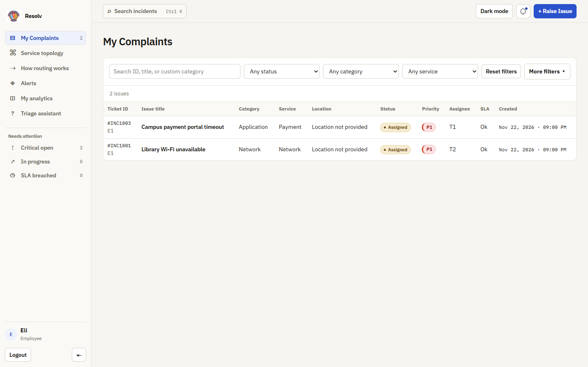
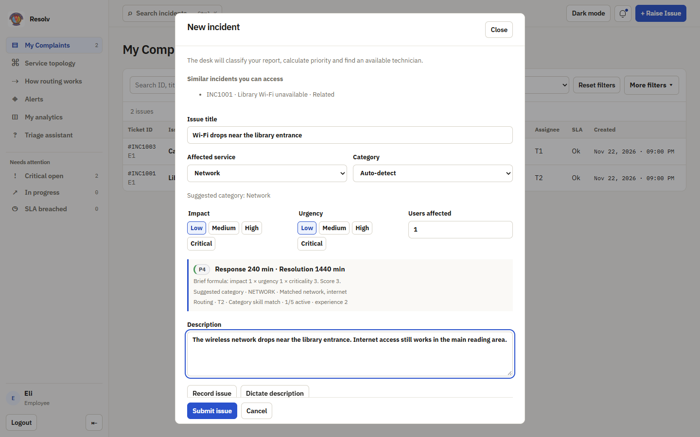
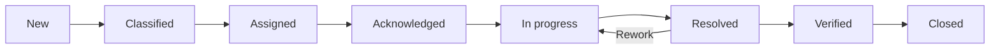
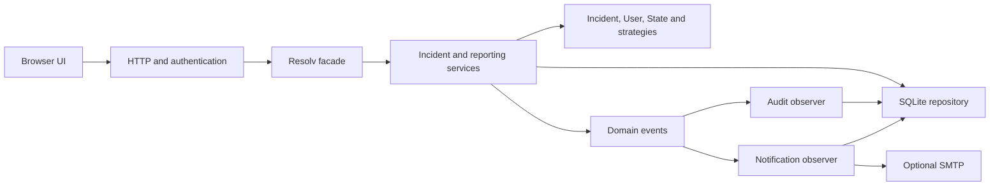

# Resolv | Campus Service Desk


**Intelligent IT Service Management and Incident Resolution**  

BITS Pilani, Hyderabad Campus · CS F213 / MAC F212 Object-Oriented Programming · Semester I, 2026–2027


When Wi-Fi goes down in a library reading area, the person reporting it wants to know who picked it up and when it is fixed. Resolv gives the reporter, technician, and administrator a shared incident record from the first report through verification and closure.


[Quick start](#quick-start) · [Highlights](#highlights) · [OOP and architecture](#oop-and-architecture) · [Testing](#engineering-and-validation) · [Project documents](#project-documents)


## Quick start


Requires **Python 3.12+**. From the repository folder:


```sh

python start_demo.py

```


Open [http://127.0.0.1:8765](http://127.0.0.1:8765) and use the demo password printed in the terminal. The core app runs with Python’s standard library, SQLite and a browser.


| Demo account | Workspace | Try this first |

| --- | --- | --- |

| `E1` / `E2` | Employee | Open **My Complaints**, then use **+ Raise Issue**. |

| `T1` / `T2` / `T3` | Technician | Open **Assigned Issues**. Sign in as the technician ID shown on your new ticket. |

| `A1` | Administrator | Open **All Issues**, **Analytics**, or **Audit log**. |


Keep the terminal running during the demo. If port 8765 is busy, use `python start_demo.py --port 8766`. Keep the local demo database and password file together. The launcher reports a mismatch and offers an explicit password reset that preserves incidents. See [setup and configuration](docs/setup.md).


## Highlights


| Capability | What the application does |

| --- | --- |

| **Preview that explains the decision** | Recommends a category, shows the priority calculation and SLA targets, and lists eligible technician recommendations before submission. |

| **Four assignment strategies** | Skill-based, load-based, experience-based, and round-robin policies share availability and capacity checks. A ticket can wait in the queue if there is no eligible technician. |

| **Response and resolution SLAs** | Separate deadlines, configurable working hours and holidays, warning and breach history, scheduled monitoring, and escalation through support tiers. |

| **Campus-aware reporting** | Reporters can select a campus area or place a pin, attach evidence, and track the same ticket through investigation and verification. |

| **Related reports and service dependencies** | Suggests potential matches and common upstream causes. Administrators can review relationships or link a parent ticket while individual records retain their own status. |

| **Notifications and audit history** | User-scoped in-app notifications stream over SSE. Email is simulated by default, with optional queued SMTP. Audit corrections and visibility changes preserve the original events. |

| **Scoped reporting** | Personal analytics for employees. Authorized support roles can export CSV within their incident scope. The server enforces the same permission used to show the export button. |

| **Optional triage and voice** | Triage uses local rules by default. Gemini suggestions require configuration and user opt-in. Local Vosk transcription and supported browser dictation are separate options. |


<details>

<summary><strong>See the employee queue and intake form</strong></summary>








</details>


## Incident workflow





Acknowledgement records the first response. Resolution records the proposed fix. The reporter verifies the result, and an administrator closes the incident. An administrator override requires a reason and can reopen a closed incident into a new SLA cycle while retaining its earlier history.


### Who can do what?


| Role | What they see and do |

| --- | --- |

| **Employee** | Create and track their own reports, attach evidence, reply to questions, verify a fix, and view personal analytics. |

| **Technician** | Review assigned issues and workload, acknowledge and investigate, request details, record the fix, and export assigned incidents. |

| **Administrator** | View all issues, close verified cases, audit actions, review related reports and account requests, and configure services, categories, strategies and SLAs. |

| **Team lead / IT manager** | See incidents that reach their escalation tier, receive escalation notifications, and export eligible records. |


### How priority and deadlines are decided


On a fresh database, the default priority policy uses impact × urgency × service criticality. Impact and urgency are capped at 3 for this formula, and service criticality 4 is mapped to 5. The score maps to P1 at 27 or more, P2 at 15 or more, P3 at 6 or more, and P4 below 6. An administrator can select a category-weighted or legacy policy instead.


| Seeded priority | Response target | Resolution target |

| --- | ---: | ---: |

| P1 | 5 min | 30 min |

| P2 | 15 min | 2 hr |

| P3 | 1 hr | 8 hr |

| P4 | 4 hr | 24 hr |


The monitor runs every 30 seconds by default. For a demo, advance **Admin → Overview → Demo clock** past the rehearsed deadline, then use **Analytics → Run SLA monitor now**. Open the incident’s **Timeline** to show the breach and escalation events.


## OOP and architecture





The design keeps lifecycle and assignment rules in the domain. The HTTP layer authenticates the caller, invokes the appropriate service and turns domain results into API responses.


| OOP concept | Where to see it |

| --- | --- |

| **Encapsulation** | [`Incident.move()`](resolv.py) checks a transition before updating the incident. The state property has no public setter. |

| **Abstraction** | [`AssignmentStrategy.pick()`](resolv.py) gives the incident service a single contract for choosing a technician. |

| **Inheritance** | `Employee`, `Technician`, `Administrator`, `TeamLead` and `ITManager` share the `User` account model. |

| **Polymorphism** | The same `actor.can_view_incident(incident)` call applies reporter ownership, technician assignment, or escalation tier according to the actor’s role. |


| Pattern | Concrete responsibility |

| --- | --- |

| **State** | Lifecycle classes define valid next states, work eligibility and entry timestamps. |

| **Strategy** | Priority and assignment algorithms can be changed without rewriting incident intake. |

| **Observer** | `EventBus` dispatches events to the audit and notification observers. |

| **Repository** | `SQLiteRepository` handles storage, queries and migrations. |

| **Factory** | `UserFactory` constructs the concrete role type. |

| **Adapter** | Notification and optional transcription adapters connect the app to external transports or runtimes. |


See the [architecture, class and use-case diagrams](docs/diagrams.md), [ER diagram](docs/er.png), and [follow-up design notes](docs/followup.md).


### Technology stack


| Layer | Implementation |

| --- | --- |

| Browser | HTML, CSS and JavaScript with role-specific workspaces |

| API | Python standard-library threaded HTTP server, REST/JSON and SSE |

| Domain | Python classes, abstract base classes, injected clock and policies |

| Storage | SQLite with versioned migrations and a private local evidence directory |

| Optional services | SMTP, Vosk/FFmpeg, browser speech recognition, Gemini |

| Delivery and checks | Docker Compose, unittest, API suites, Playwright and GitHub Actions |


## Engineering and validation


- **Authentication and access:** salted PBKDF2-HMAC-SHA256 hashes, expiring session tokens, failed-login throttling, and server-side role and ownership checks. Employee CSV requests are refused even if sent directly to the API.

- **Persistence:** SQLite transactions keep incident operations, audit records and durable notifications consistent. Versioned migrations preserve existing records.

- **Repeatable tests:** the [GitHub Actions workflow](.github/workflows/checks.yml) is configured to run unit, API and browser suites on pushes and pull requests. See the [test catalogue](docs/test-catalog.md) for scenarios and expected results.


```sh

python -m unittest

python tests_e2e/e2e_login_api.py

python tests_e2e/e2e_followup_api.py

```


The Windows validation recorded in the [changelog](CHANGELOG.md) includes **59 passing unit tests**, five API suites on the reliability release, and targeted real Edge checks. The CSV and role changes were rechecked with the unit suite, follow-up API suite, and an Edge export check. The full Python Playwright suite and live integrations were outside that local run.


For the full test commands, normal server setup, Docker, SMTP and voice configuration, see [setup and configuration](docs/setup.md).


## Project documents


| Document | What it covers |

| --- | --- |

| [Final project report](Resolv_Project_Report.pdf) | Requirements, architecture, UML, security, test catalogue and recorded validation |

| [Detailed presenter script](docs/Resolv_Detailed_Presenter_Script.pdf) | Click paths, narration and handoffs for all four presenters |

| [Enhancement design](docs/enhancements.md) | Lifecycle extensions, audit behavior, campus data and reporting |

| [Historical audit and viva material](AUDIT_REPORT.pdf) · [Viva guide](VIVA_PREPARATION.pdf) | Earlier project notes. Use the current report and changelog for current behavior and test results. |
| [Changelog](CHANGELOG.md) | Reliability fixes, access changes and verification results |


## Team


| Member | BITS ID |

| --- | --- |

| Sujoy Kumar Ghosh | 2024B1A71088H |

| Prakhar Nigam | 2024B4A70816H |

| Wamika Sehgal | 2024B4A70830H |

| Ronak Laharwani | 2024B1A71193H |

