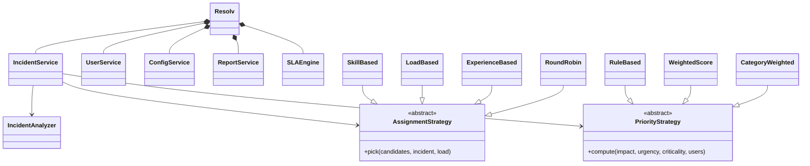
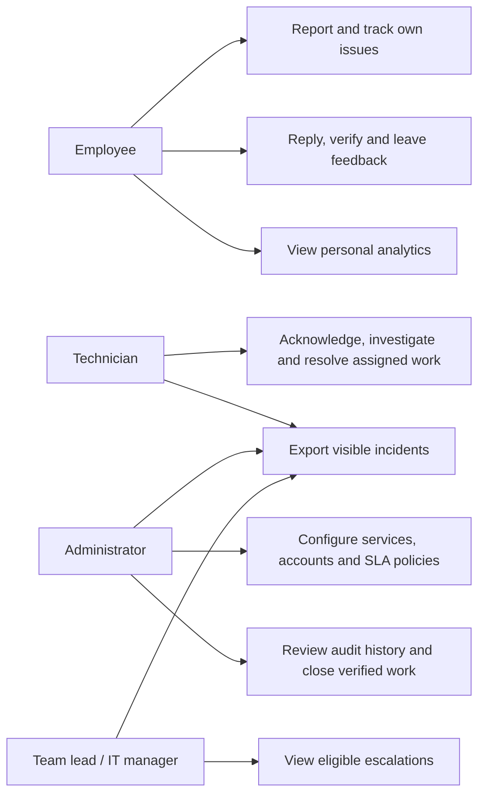

# Resolv diagrams

[Back to the README](../README.md) · [Final project report](../Resolv_Project_Report.pdf)

## Application architecture

```mermaid
flowchart TD
    Browser["Browser workspaces"] --> API["HTTP server: sessions, validation, authorization"]
    API --> Facade["Resolv facade"]
    Facade --> Services["IncidentService, UserService, ConfigService, ReportService"]
    Services --> Domain["User, Incident, State, assignment and priority strategies"]
    Services --> Repo["SQLiteRepository and schema migrations"]
    Services --> Bus["EventBus"]
    Bus --> Audit["AuditObserver"]
    Bus --> Notify["NotificationObserver"]
    Audit --> Repo
    Notify --> Repo
    Notify --> Mail["In-app feed and optional SMTP"]
    API --> Evidence["Private attachment storage"]
```

## Services and strategy contracts

## Role use cases

The [domain class diagram](class_a.png), [observer and repository diagram](class_c.png), [incident lifecycle](state.png), and [ER diagram](er.png) provide more detail.
