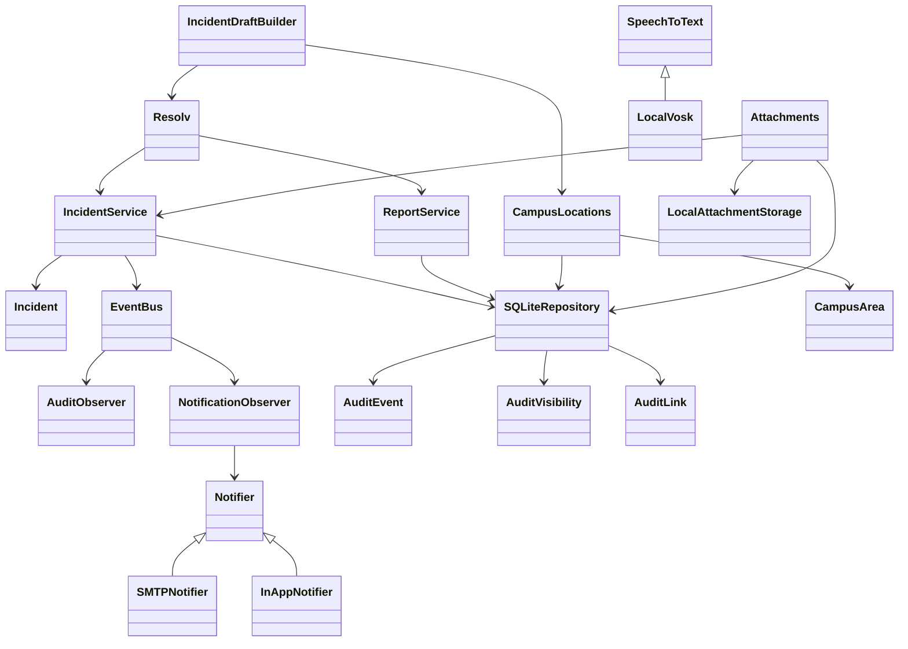

# Resolv enhancement design

## Lifecycle and audit

Ordinary actions use the existing state machine and role permissions. Administrators can perform technician actions regardless of assignment. Admin Override validates the proposed fields, requires a reason, and records old and new values. A forced transition records both the lifecycle event and the override. Reassignment through this action requires an available technician with room in their workload if the assignment increases their active load.

A closed incident can be reopened into an active state. Reopening keeps the original incident ID, original creation time, latest closure timestamp, and earlier audit history. The new SLA cycle starts at reopening and clears previous response and resolution markers, escalation level, and SLA warning flags. Reopening directly into Acknowledged or In Progress records a response in the new cycle at the time of the override. An override priority stays in effect until an administrator explicitly restores automatic scoring.

An audit event has a stable SQLite primary key. A separate visibility row controls whether the default audit view includes it. Hide, restore, and correction operations append their own events and link them to the original event ID. The complete export includes hidden events and those links.

## Reporting and analytics

A manually selected Other category requires a custom label. The automatic classifier can still use Other when no category matches. Administrators can review custom-label counts and use a label when adding a configured category. Existing reports retain their stored category.

The dashboard uses creation date and counts each incident once, including reopened incidents. Open means the incident is in a pre-resolution state. Active workload includes assigned, acknowledged and in-progress incidents. An active deadline is at risk when its elapsed-window forecast reaches 80 percent. Priority, category and technician workload can bring this warning forward after half the window has elapsed. Response and resolution breaches both advance escalation. Each level emits a separate event. The engine checks the breached SLA window at one, two and three times its duration. SLA Breached means a response or resolution deadline was missed. Campus totals include separate counts for missing locations and pins without named areas. The displayed map aggregates by named area.

## Group 65 recommendations applied

The browser asks the server to preview classification, priority and SLA targets. Intake repeats the calculations and uses the configured assignment strategy. A SQLite sequence reserves incident IDs, and creation, audit rows and durable notifications share the transaction. Severity, service and affected-user counts are validated on the server.

Incident reads, notes, information requests, attachments, insights and preview matches use role and incident access checks. Requests revalidate the session principal from SQLite. Persisted notifications and their SSE representation are scoped to that user. For SSE clients, use an authenticated GET to `/api/notifications/events` and resume with `Last-Event-ID`. An empty response returns after a short wait. Login throttles are keyed independently by account and source address.

Configure service dependencies from **Service topology**. Dependencies and incident parent links reject cycles. Correlation ranks the nearest shared upstream service with open incidents visible to the current user. The result is presented as a possible cause for review.

## Component relationships

